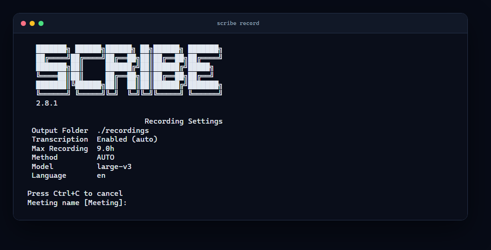

# Scribe

[](https://github.com/blisspixel/scribe/actions/workflows/ci.yml)
[](LICENSE)
[](https://www.python.org/downloads/)

Local-first speech transcription, meeting notes, and defensive OBS recording for
Windows, macOS, and Linux.

Scribe runs transcription on your machine by default. It works on CPU, uses
compatible NVIDIA hardware automatically, and offers optional Apple Silicon, AMD,
and Intel backends. Cloud transcription and AI-generated extras are explicit
opt-ins.

## Quick start

Scribe requires Python 3.12 or 3.13, [uv](https://docs.astral.sh/uv/), and FFmpeg.
OBS Studio is required only for recording.

```bash
uv tool install --python 3.12 git+https://github.com/blisspixel/scribe.git@v2.8.1
uv tool update-shell

scribe init
scribe doctor
scribe meeting.mp4
```

Open a new terminal after `uv tool update-shell`. GitHub access is required while
the repository is private. This project is not published on PyPI, where an
unrelated package uses the same name.

For setup variants, optional backends, upgrades, and recovery, see the
[deployment guide](docs/DEPLOYMENT.md).

## What Scribe does

- Transcribes local audio and video into TXT, JSON, DOCX, Markdown, VTT, and SRT.
- Downloads and transcribes supported media URLs.
- Processes batches and music collections with truthful partial-failure results.
- Records through OBS without taking control of an existing recording.
- Adds optional local speaker labels and vocabulary correction.
- Generates opt-in notes, jokes, and memes with a selected local or cloud provider.
- Provides optional speech-to-type, read-aloud, and resident voice hotkeys.
- Searches structured transcript archives.

## Common workflows

```bash
scribe meeting.mp4
scribe url https://example.com/podcast.mp3
scribe batch *.mp4
scribe meeting.mp4 --notes
scribe rec --check
scribe rec "Team Meeting"
scribe query "action item"
```



Use `scribe --help` or `scribe COMMAND --help` for version-matched options. The
[CLI guide](docs/CLI.md) covers commands, common flags, exit behavior, and session
evidence.

## Recording that fails safe

Recording is a data-preservation workflow. The normal control path requires
advancing OBS output counters and independently checks for a fresh growing file.
The emergency path requires file growth before it reports confirmation. Scribe
never stops or replaces a recording that was already active. If capture ends
unexpectedly, it preserves the partial file and reports an incomplete session.

Run `scribe rec --check` before an important meeting. The
[recording guide](docs/RECORDING.md) explains OBS setup, normal and emergency
control paths, platform requirements, monitoring, safe stop, and recovery. The
[troubleshooting guide](docs/TROUBLESHOOTING.md) provides symptom-specific fixes.

## Local and explicit by default

`scribe meeting.mp4`, `--method auto`, and `--method local` stay local and do not
require an API key. Cloud transcription requires `--method openai`. Notes, jokes,
and memes are disabled by default and require positive flags.
`SCRIBE_LOCAL_ONLY=1` adds a strict cloud-provider guard. `scribe doctor` is local;
`scribe doctor --live` is the explicit provider-connectivity check.

No particular GPU is required. The standard backend runs on CPU and compatible
NVIDIA GPUs. Optional `mlx` and `whispercpp` installs support Apple Silicon and
portable AMD or Intel paths. Run `scribe doctor` to see the available backend.

## Optional resident voice

The tray adds tap-to-toggle dictation and selection read-aloud:

```bash
scribe tray --setup
scribe tray --check
scribe tray
```

The full Python tray is live-validated on Windows. macOS and Linux remain
experimental until their hardware validation records are complete. Installation,
hotkeys, permissions, single-instance ownership, and recovery are in the
[resident voice guide](docs/VOICE.md).

## Reliable outcomes

Started workflows write unique session summaries and distinguish complete,
partial, failed, and instrumental outcomes. Incomplete work exits nonzero without
discarding usable artifacts. `scribe support-bundle` creates a bounded, redacted
diagnostic bundle for review before sharing.

## Documentation

- [Recording guide](docs/RECORDING.md)
- [CLI guide](docs/CLI.md)
- [Deployment guide](docs/DEPLOYMENT.md)
- [Resident voice guide](docs/VOICE.md)
- [Troubleshooting guide](docs/TROUBLESHOOTING.md)
- [Architecture](docs/ARCHITECTURE.md)
- [Development guide](docs/DEVELOPMENT.md)
- [Responsible use](docs/RESPONSIBLE_USE.md)
- [Security policy](SECURITY.md)
- [Roadmap](ROADMAP.md) and [changelog](CHANGELOG.md)
- [Complete documentation index](docs/README.md)

## Project status

Version 2.8.1 is the current GitHub release for repository collaborators. It is
not published on PyPI. CI enforces Ruff, strict mypy, an 81 percent combined
statement-and-branch coverage floor, dependency and artifact audits, and native
source checks. Platform evidence still in progress is tracked in the
[roadmap](ROADMAP.md).

## Responsible use and security

Use Scribe only for lawful, authorized recording and processing. Obtain every
consent required by law, policy, and context. Cloud features send relevant audio
or text to the selected provider; local transcription does not. Review
[Responsible Use](docs/RESPONSIBLE_USE.md) before recording other people or
processing sensitive material. Report vulnerabilities through the
[security policy](SECURITY.md).

## License and contributing

Copyright 2026 Nick Seal. Scribe is licensed under the
[Apache License 2.0](LICENSE). Dependencies, models, and external executables keep
their own licenses; see
[deployment and redistribution](docs/DEPLOYMENT.md#licensing-and-redistribution).

See [CONTRIBUTING.md](CONTRIBUTING.md) and the
[development guide](docs/DEVELOPMENT.md) to contribute.
